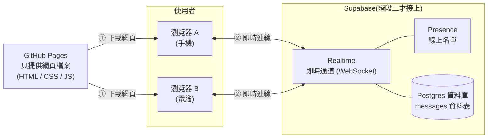
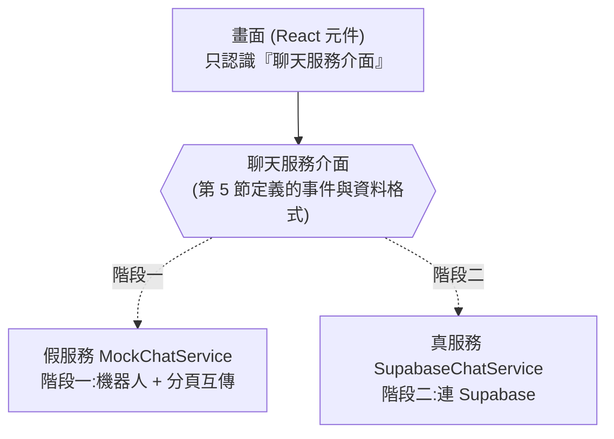
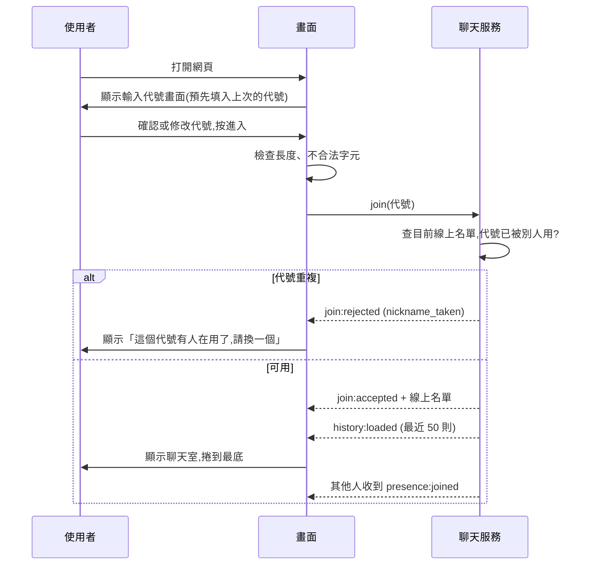
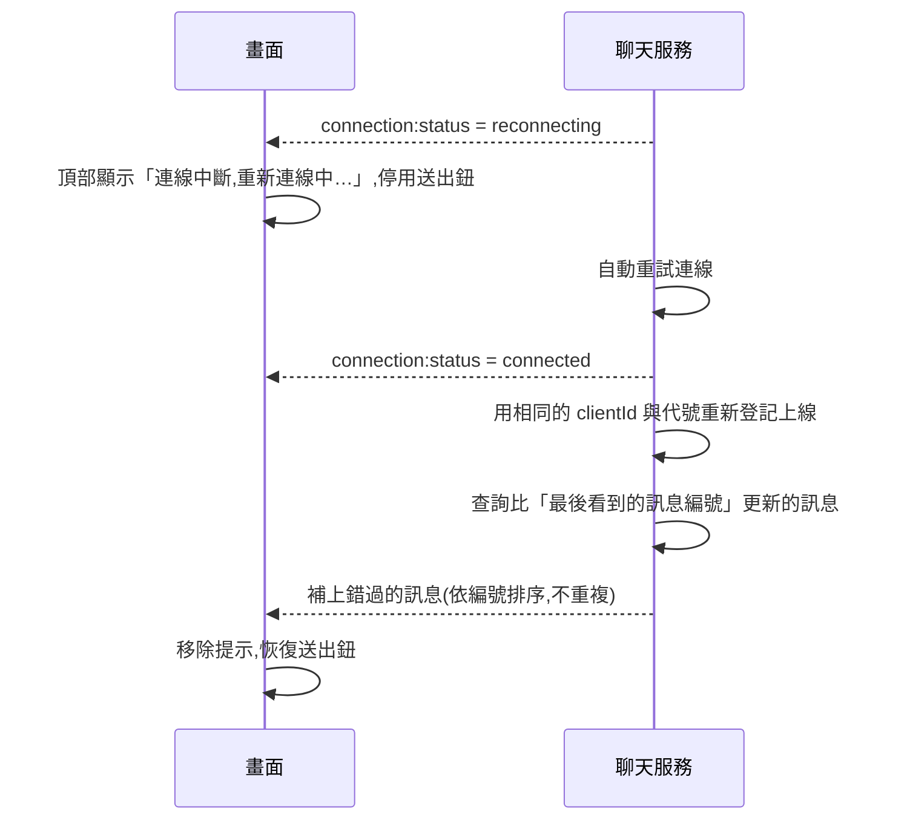

# 匿名聊天室:架構文件

> 這份文件寫給「不寫程式的專案負責人」看。專有名詞第一次出現時,會用一句話解釋。
> 需求來源:`docs/requirements.md`,以及之後逐題確認的使用者行為(整理在第 7 節)。
> 這份文件只講「怎麼設計」,不包含任何程式碼,也不規定顏色和樣式(那是 `/design` 和 `/frontend-design` 的工作)。

---

## 1. 專案說明與目標

**這是什麼:** 一個不用註冊、不用登入的匿名聊天室。所有人都在同一個聊天室裡,只要知道網址就能進來,電腦和手機都能用。

**使用者會做的事:**
1. 打開網頁,輸入一個代號(暱稱)。
2. 進入聊天室,看到最近的訊息、誰在線上,並且可以送出訊息。
3. 有人進來或離開時,對話中會出現提示。

**目標:**
- 先把前端做好,放上 GitHub Pages,讓大家看得到(階段一)。
- 最後才接上 Supabase,讓不同人的瀏覽器真正連在一起(階段二)。
- 接上 Supabase 時,前端不需要整個重寫。

**除了基本聊天,另外做了三個新增功能**(詳見第 14 節):搜尋訊息、即時「正在輸入」提示、伺服器端強制的發送頻率限制。

**不是目標:** 帳號系統、私訊、多個聊天室、圖片傳輸、管理後台(完整清單見第 10 節)。

---

## 2. 整體架構圖

先用白話說明三個角色:

- **瀏覽器**:使用者手上的手機或電腦。聊天室的畫面和所有操作邏輯都在這裡執行。
- **GitHub Pages**:GitHub 提供的免費網頁空間。它只負責「把網頁檔案交給瀏覽器」,**不會處理任何聊天內容**。
- **Supabase**:一個線上的後端服務(可以想成「幫你管資料和即時傳訊的雲端後台」)。聊天訊息的儲存和即時轉送都靠它。



**怎麼讀這張圖:**
1. 使用者打開網址,瀏覽器從 GitHub Pages 下載網頁。這一步之後,GitHub Pages 就沒事了。
2. 網頁在瀏覽器裡跑起來,直接和 Supabase 建立一條**WebSocket**(一條保持開著的網路連線,伺服器有新東西可以立刻推給你,不用一直問「有新訊息嗎?」)。
3. 所有人的訊息都經過 Supabase 轉給其他人。我們**不需要自己架任何伺服器**。

---

## 3. 技術選擇

每一項都寫「選了什麼」和「為什麼」。

### 3.1 前端

| 項目 | 選了什麼 | 為什麼 |
|---|---|---|
| 程式語言 | **TypeScript** | 它是 JavaScript(網頁唯一的原生程式語言)加上「型別檢查」,可以在寫錯資料格式時立刻提醒。第 5 節的訊息格式就靠它來把關,階段二接 Supabase 時才不容易出錯。 |
| 畫面框架 | **React** | 框架是「蓋畫面的工具組」。聊天室的畫面會一直變(新訊息、人進出、斷線提示),React 擅長「資料一變,畫面自動跟著更新」。資料多、教學多,日後 AI 協助修改也最穩。 |
| 建置工具 | **Vite** | 把我們寫的原始碼打包成瀏覽器能看的網頁檔案(這個動作叫「建置 build」)。它快、設定少,和 GitHub Pages 搭配的做法很成熟。 |
| 畫面樣式 | 純 CSS(不指定套件) | 樣式交給 `/design` 與 `/frontend-design`,這裡只要求它支援淺色/深色自動切換、手機與電腦兩種版面。 |
| Supabase 連線套件 | **@supabase/supabase-js** | Supabase 官方提供的程式庫,負責建立 WebSocket 連線、訂閱資料庫變化、Presence 與 Broadcast,不用自己處理底層細節。只在階段二的聊天服務(`SupabaseChatService`)裡使用。 |
| 單元測試 | **Vitest** | 只用來測「純邏輯」(代號檢查、顏色計算、送出頻率限制),不測畫面。 |

**為什麼不用純 HTML(不用框架)?** 可以做,但這個聊天室有不少狀態要同步管理(連線狀態、捲動位置、名單、斷線重連),純 HTML 會寫成一團難維護的程式。用 React 的成本是需要建置步驟,但 GitHub Actions 可以自動做,你不用手動處理。

**為什麼不用 Next.js 之類的?** 它們需要自己的伺服器,而 GitHub Pages 只能放靜態檔案(內容固定、不會在伺服器端運算的檔案)。

**需要的工具:** 開發時電腦要安裝 **Node.js**(讓你的電腦能執行建置工具的環境)。這份文件階段不安裝,動工時再裝。

### 3.2 Supabase 用哪些功能

Supabase 有很多功能,這個專案只用以下幾個:

| 功能 | 用來做什麼 | 為什麼選它 |
|---|---|---|
| **Database(Postgres 資料庫)** | 存放聊天訊息,讓新進來的人看得到最近 50 則 | 需求要求「新人看得到最近的訊息」,代表訊息必須被存起來。資料庫就是存東西的地方。 |
| **Realtime 的 Postgres Changes** | 資料庫一多了新訊息,就即時推給所有在線的瀏覽器 | 「存起來」和「推給大家」是同一件事,不會出現「推了但沒存」或「存了但沒推」的不一致,斷線補訊息也用同一份資料,最不容易出錯。 |
| **Realtime 的 Presence** | 管理「誰在線上」,以及進來/離開的事件 | Presence 就是為這個設計的:每個瀏覽器登記「我在線上」,關掉分頁或斷線後,幾秒內系統會自動當作「離開」。我們不用自己寫「判斷誰掉線了」的邏輯。 |

| **Realtime 的 Broadcast(只用在「正在輸入」)** | 轉送「○○ 正在輸入」這種**不需要保存**的即時提示 | 提示過了就沒有意義,存進資料庫反而浪費。聊天**訊息本身**不走 Broadcast(見下方)。 |
| **資料庫觸發器(Trigger)** | 在訊息寫入資料庫之前先檢查「是不是送太快」,太快就整筆拒絕 | 這是**伺服器端強制**的規則:就算有人不用我們的網頁、直接呼叫 Supabase 的 API,也一定會經過這個檢查(見第 9.1、14 節)。 |

**刻意不用的功能:**
- **Auth(登入系統)**:需求明說不要登入。
- **用 Realtime Broadcast 傳聊天訊息**:它只轉送、不儲存。如果訊息走 Broadcast,還得另外再寫一次資料庫,等於做兩份工作,而且兩邊容易對不起來。所以只有「正在輸入」這種用完即丟的提示才用 Broadcast。
- **Storage(檔案儲存)、Edge Functions(伺服器端函式)**:不傳檔案、不需要自己的後端程式。

**這個選擇的代價(誠實說明):** Postgres Changes 在超大量使用者時效能不如 Broadcast。但這個聊天室預期人數不多,而且免費方案的連線數上限(見 9.2)本來就先到,所以這個代價可以接受。

---

## 4. 兩個階段,以及怎麼避免重寫

### 4.1 階段一:還沒接 Supabase

**目標:** 整個聊天室的畫面和操作都能運作、能在 GitHub Pages 上打開來看、能被 `/design` 調整外觀。

**階段一做得到的事:**
- 代號輸入、重複檢查、記住上次的代號。
- 進入聊天室、看到(假的)歷史訊息、送出訊息、字數限制、送太快的限制。
- 線上名單、進來/離開提示、新訊息按鈕、顏色分配。
- 斷線提示畫面(可以用一個隱藏的測試開關手動觸發,讓你看得到這個畫面)。
- 同一台電腦**開兩個分頁**,可以在兩個分頁之間互相聊天(用瀏覽器內建的 BroadcastChannel,同一個瀏覽器內分頁互傳訊息的功能)。
- 聊天室裡有幾個**機器人(假使用者)**,會定時說話、進出,讓畫面看起來是活的,方便設計外觀。

**階段一做不到的事(要先講清楚):**
- **不同人、不同裝置之間無法真的聊天。** 你拿手機、朋友拿他的手機,看到的是各自的假聊天室。這是正常的,要等階段二。
- 階段一的假訊息存在瀏覽器本機,同一個瀏覽器重新整理後仍看得到;清除網站資料,或在網址加 `?debug` 用「清掉我送過的訊息」可重置。
- **這是階段一的描述。** 現在(階段二)的正式網站訊息是存在 Supabase 資料庫,見第 9.3 節。

**怎麼在 GitHub Pages 上看到效果:** 每次把程式推到 GitHub 的 `main` 分支,GitHub 會自動建置並更新網頁(細節見第 12 節)。你只要打開 `https://<你的帳號>.github.io/<repo 名稱>/` 就能看。手機和電腦都用同一個網址測試。

### 4.2 階段二:接上 Supabase

**改變的事:**
1. 在 Supabase 建立專案、資料表和權限規則(第 8 節、第 4.3 節)。
2. 新增一份「真的連 Supabase」的聊天服務,取代階段一的假服務。
3. 在 GitHub 設定兩個變數(網址與公開金鑰),重新部署。
4. 換上真實資料之後,機器人和假歷史訊息消失。(假服務的程式仍保留,`VITE_CHAT_BACKEND=mock` 時使用,方便沒有網路時開發與測試。)

**實際上動到的範圍(如實記錄):** 主要是新增 `SupabaseChatService.ts` 並在 `createChatService.ts` 加一個分支。另外有幾處小幅度連動:`types.ts`(`join:rejected` 多了一種原因 `unavailable`,對應第 9.2 節「連不上要有明確錯誤」)、`useChat.ts` 與 `JoinScreen.tsx`(顯示這個新原因的錯誤訊息)、`vite-env.d.ts`(新的環境變數名稱)、`deploy.yml`(把網址與公開金鑰帶進建置)、`package.json`(新增 Supabase 套件)。畫面的版型與操作邏輯沒有因為換服務而改。

### 4.3 兩階段之間,前端怎麼設計才不用重寫

核心做法:**把「畫面」和「資料從哪來」分開,中間隔一層固定的介面。**



- **聊天服務介面**:一份「合約」,規定聊天服務一定要提供:加入聊天室、送出訊息、離開、以及會發出哪些事件(第 5 節)。
- 畫面**只**和這份合約說話,完全不知道背後是假的還是真的。
- 用一個設定值決定現在用哪一個(`mock` 或 `supabase`),由建置時的環境變數決定。換階段只要改這個設定,不用動畫面。
- **重要規則:** 假服務必須「說同樣的話」。它發出的事件名稱、資料格式、順序、時間差(例如連線要花一點時間)都和真服務一致,否則階段二接上後,畫面會遇到沒看過的情況。
- 純邏輯(代號驗證、顏色計算、送出頻率限制、訊息清理)放在獨立的模組,兩個階段共用,也能單獨測試。

---

## 5. 通訊約定

這一節是整個專案最重要的「合約」。畫面、假服務、真服務都照這一節來。

### 5.1 資料格式

**使用者 (User)**

| 欄位 | 說明 |
|---|---|
| `clientId` | 這個瀏覽器分頁的隨機識別碼。用來認出「這是同一個人重新連線」,不是帳號,關掉分頁就沒用了。 |
| `nickname` | 代號,1~12 個字 |
| `joinedAt` | 加入時間(用來在同時搶同一個代號時決定誰先) |

**訊息 (Message)**

| 欄位 | 說明 |
|---|---|
| `id` | 訊息編號,資料庫給的,**嚴格遞增**。用來排序、也用來斷線後「補抓比這個編號新的訊息」。 |
| `clientId` | 送出者的識別碼 |
| `nickname` | 送出當下的代號 |
| `content` | 內容,純文字,1~500 字 |
| `createdAt` | 送出時間,由資料庫決定(不信任使用者的手機時鐘) |

**顏色:** 不存在資料裡。由畫面用「代號」計算出來(同一個代號永遠得到同一個顏色)。這樣不用多存欄位,階段一和階段二的結果也一致。
顏色的來源是固定的一組顏色(由 `/design` 決定色票,約 8~12 色),所以不同代號有機會撞色,這是可接受的。

**資料庫的 `messages` 資料表(階段二)** 就是上面訊息的欄位,另外在資料庫層加上限制:內容不能是空白、不能超過 500 字;代號不能是空白、不能超過 12 字;`client_id` 不能超過 64 字。訪客新增訊息時**只能填 `client_id`、`nickname`、`content` 三欄**,訊息編號與時間由資料庫自己決定(用資料表權限強制,不是靠網頁自律)。完整 SQL 在 `supabase/migrations/`。

### 5.2 聊天服務介面的「動作」(畫面叫服務做事)

| 動作 | 說明 |
|---|---|
| `join(nickname)` | 加入聊天室。可能成功,也可能因代號重複被拒絕。 |
| `sendMessage(content)` | 送出一則訊息。 |
| `setTyping(true/false)` | 告訴別人「我正在輸入 / 停止輸入」(新增功能)。服務自己限制發送次數,畫面可以每次按鍵都呼叫。 |
| `leave()` | 主動離開(例如切換回輸入代號畫面)。使用者沒有「離開按鈕」,但程式內部需要這個動作。 |

### 5.3 聊天服務介面的「事件」(服務通知畫面)

| 事件名稱 | 何時發出 | 帶的資料 |
|---|---|---|
| `connection:status` | 連線狀態改變 | `connecting` / `connected` / `reconnecting` |
| `join:accepted` | 加入成功 | 目前線上名單 |
| `join:rejected` | 加入被拒絕 | 原因:`nickname_taken`(代號重複)、`unavailable`(一直連不上:網路不通、服務暫停、達到連線上限) |
| `history:loaded` | 載入最近 50 則訊息 | 訊息陣列(由舊到新) |
| `message:new` | 有新訊息(含自己送的) | 一則 Message |
| `message:failed` | 自己的訊息送出失敗 | 原本的內容、失敗原因(`offline`:斷線;`rate_limited`:被伺服器的頻率限制擋下;其他:資料庫回報的錯誤) |
| `presence:sync` | 線上名單整份更新 | User 陣列 |
| `presence:joined` | 有人進來 | 一個 User |
| `presence:left` | 有人離開 | 一個 User |
| `typing:changed` | 別人開始或停止輸入(新增功能) | `{ clientId, typing }`。服務負責逾時:超過 5 秒沒收到更新就自己當作停止。 |
| `rate:limited` | (階段一實作時調整)送太快的判斷放在前端的 `useChat`,不經過聊天服務,所以服務不會發出這個事件 | — |

**系統提示(進來/離開那行灰色小字)只由 `presence:joined` / `presence:left` 產生,絕對不會從 `messages` 資料表來。** 這樣別人就無法用「發一則內容是『某某 離開了』的訊息」來偽造系統提示。

### 5.4 Supabase 對應(階段二)

| 通訊約定 | Supabase 做法 |
|---|---|
| `message:new` | 訂閱 `messages` 資料表的新增事件(Postgres Changes) |
| `typing:changed` / `setTyping` | Realtime Broadcast 的 `typing` 事件(不寫入資料庫) |
| `sendMessage` | 在 `messages` 資料表新增一列,**不另外先在畫面上假裝送出**;等資料庫的新增事件回來才顯示,這樣所有人看到的順序一致 |
| `history:loaded` | 查詢編號最大的 50 列,再反轉成由舊到新 |
| `presence:*` | Presence,每個瀏覽器登記 `{clientId, nickname, joinedAt}` |

---

## 6. 資料流

### 6.1 進入聊天室



重點:
- 代號會存在瀏覽器本機(下次預先填入),這只是方便,不是登入。
- 「代號是否重複」只和**目前在線上**的人比對。有人離開後,代號就釋出。
- **同一個瀏覽器分頁重新整理**時,舊連線可能還要幾秒才會被判定離開;此時 `clientId` 相同的同名者視為「同一個人」,允許通過,不算重複。
- **兩個人同一瞬間搶同一個代號**:雙方都會登記,系統以 `joinedAt` 較早者為準,較晚的人會被通知「代號重複」並回到輸入畫面。這是前端層級的檢查,不是絕對保證(見 9.1)。

### 6.2 送出訊息

1. 使用者輸入文字,按 Enter(電腦)或送出鈕(手機)。
2. 畫面先做檢查:去掉前後空白、內容不能為空、不超過 500 字、送出頻率沒超標。任何一項沒過就不送出,並顯示對應提示。
3. 通過後呼叫 `sendMessage`,輸入框清空。
4. 訊息進入資料庫,所有人(包含自己)收到 `message:new`,畫面才顯示。
5. 若失敗(例如斷線、**被伺服器的頻率限制擋下**),發出 `message:failed`,畫面在輸入區顯示「送出失敗」並把原本的文字放回輸入框,不會讓使用者的字消失。
6. 收到新訊息時的捲動:使用者停在最底 → 自動捲到最新;使用者正在往上看舊訊息 → 不打斷,顯示「有新訊息 ↓」按鈕。

### 6.2.1 正在輸入(新增功能)

1. 使用者在輸入框打字時,畫面通知服務 `setTyping(true)`。服務**最多每 2.5 秒才實際發一次**,不會每個按鍵都送。
2. 服務用 Realtime Broadcast 把 `{ clientId, typing: true }` 傳給其他人(自己收不到自己的)。
3. 其他人的服務檢查格式(必須是有 `clientId` 字串與 `typing` 布林值的物件、不是自己),通過後發出 `typing:changed`。畫面只顯示**目前在線上名單裡**的人,代號取自 Presence,**不取自 Broadcast 內容**。
4. 以下情況提示會消失:對方清空輸入框或停止打字 3 秒(對方送出 `typing: false`)、對方送出訊息、對方離開、對方關掉分頁或斷線(超過 5 秒沒收到更新,收的一方自己清除)、自己斷線。

### 6.3 離開

使用者**沒有離開按鈕**。關掉分頁、關掉瀏覽器、切換到別的網站都算離開。
1. 瀏覽器斷開連線。
2. Presence 在幾秒內(依網路狀況,通常數秒到十幾秒)發現這個人不見了。
3. 其他人收到 `presence:left`,線上名單移除該人,對話中插入「○○ 離開了」。
4. 該代號此時才可被別人使用。

### 6.4 斷線重連



重點:
- 重連時用**相同的 `clientId`**,所以代號不會被別人搶走,也不會被當成新人。
- 補訊息是用「訊息編號」判斷,所以不會漏,也不會重複顯示。
- 短暫斷線時,其他人可能先看到「○○ 離開了」,隨後又看到「○○ 進來了」。這是 Presence 機制的正常現象,這一版接受,不另外壓抑。
- 斷線時間很長、而代號在此期間被別人用了:重連失敗,畫面回到輸入代號畫面,並說明「連線中斷太久,代號已被使用,請重新選擇」。
- 斷線期間,送出鈕停用,所以使用者不會在不知情下丟失訊息。

---

## 7. 畫面清單

只有兩個畫面。下面只寫「有什麼元素、各自的行為」,不規定顏色與樣式。整體氣質是「安靜簡約」,自動跟隨系統的淺色/深色設定,介面全部使用繁體中文,電腦與手機都要好用,這些交給 `/design` 處理。

### 7.1 畫面 A:輸入代號

| 元素 | 行為 |
|---|---|
| 標題與一句簡短說明 | 說明這是匿名聊天室 |
| 代號輸入框 | 如果之前用過,預先填入上次的代號並可修改。即時顯示字數(上限 12)。 |
| 錯誤提示區 | 顯示:代號為空、超過 12 字、含不允許的字元、代號重複、連不上聊天室(網路不通、服務暫停)、(重連失敗被送回時)連線中斷太久。 |
| 「進入」按鈕 | 代號不合法時不能按;按下後顯示「連線中」狀態並防止重複點擊。按 Enter 也可以進入。 |
| 載入狀態 | 連線、檢查代號的短暫期間顯示。 |

### 7.2 畫面 B:聊天室

**整體結構:** 頂部列、(電腦版)右側線上名單、中間訊息區、底部輸入區。

| 元素 | 行為 |
|---|---|
| **頂部列** | 顯示聊天室名稱與「線上 N 人」。手機版點「線上 N 人」展開名單(再點一次或點外面收起);電腦版這裡只顯示人數,名單在右側。 |
| **搜尋鈕與搜尋列(新增功能)** | 頂部列右側的放大鏡圖示。按下後出現搜尋列,輸入關鍵字即時篩選**目前已載入的訊息**(內容或代號含關鍵字,不分大小寫),符合的文字會標示,並顯示「找到 N 則訊息」或「沒有符合的訊息」。按 Esc 或關閉鈕離開搜尋、恢復全部訊息。只在自己的畫面上篩選,不經過伺服器。 |
| **「正在輸入」提示(新增功能)** | 輸入框上方一行小字:「○○ 正在輸入…」、「○○、△△ 正在輸入…」、三人以上「多人正在輸入…」。固定保留一行高度,出現與消失時畫面不會跳動。 |
| **斷線提示條** | 連線中斷時出現在頂部:「連線中斷,重新連線中…」;連回來後自動消失。 |
| **線上名單** | 每位使用者一行:顏色標記 + 代號。自己要有標示(例如「(你)」)。有人進出時即時更新。電腦版固定顯示於右側。 |
| **訊息區** | 由舊到新排列。每則訊息顯示:顏色標記、代號、內容、時間(例如 14:32)。自己的訊息靠右,別人的靠左。內容保留換行,過長會自動折行,**一律當純文字顯示**。 |
| **系統提示行** | 對話中插入的灰色小字:「○○ 進來了」/「○○ 離開了」。隨訊息一起往上捲。只記錄「自己在線期間」發生的進出,晚進來的人看不到更早的進出提示(因為這些不存資料庫)。 |
| **載入中狀態** | 進入時載入最近 50 則訊息的期間顯示。 |
| **空狀態** | 如果完全沒有訊息,顯示一句歡迎語。 |
| **「有新訊息 ↓」按鈕** | 只在使用者往上看舊訊息、而又有新訊息進來時出現,點了跳到最底並消失。使用者自己捲到最底時也會消失。 |
| **輸入框** | 多行文字框。電腦:Enter 送出、Shift+Enter 換行。手機:Enter 是換行,用送出鈕送出。顯示剩餘字數(接近 500 字時才提醒)。 |
| **送出鈕** | 內容為空、超過 500 字、斷線中、被限速時,不能按。 |
| **限速提示** | 送太快時,送出鈕暫時停用,顯示「送太快了,請稍等一下」(含倒數秒數),時間到自動恢復。 |
| **送出失敗提示** | 訊息送出失敗時,文字回到輸入框,並顯示「送出失敗,請再試一次」。如果是被伺服器的頻率限制擋下,改顯示「送太快了,伺服器暫時擋下這則訊息,請稍等幾秒再送」。 |

**特別注意(手機):** 虛擬鍵盤跳出來時,輸入區不能被遮住,訊息區要能正確縮小。這是手機版最常見的問題,驗證清單中會列為必測項目。

---

## 8. 金鑰

「金鑰」是一串很長的字,用來向 Supabase 證明「是這個專案的網頁在跟你說話」。有些金鑰可以公開,有些絕對不行,分清楚是這一節的重點。

### 8.1 這個專案會碰到的東西

| 名稱 | 是什麼 | 可以公開嗎 | 放在哪裡 |
|---|---|---|---|
| **Project URL** | 你的 Supabase 專案網址 | ✅ 可以 | 前端(網頁會用到) |
| **Publishable key(公開金鑰)**<br/>舊版叫 `anon` key | 讓網頁以「訪客身分」連線。**它的權限由資料庫的規則(RLS)限制,不是由金鑰本身限制。** | ✅ 可以,**本來就會出現在網頁裡**,任何人打開瀏覽器工具都看得到 | 前端(透過環境變數) |
| **Secret key(祕密金鑰)**<br/>舊版叫 `service_role` key | 擁有管理者權限,**可以繞過所有權限規則,讀寫、刪除一切資料** | ❌ **絕對不行** | **這個專案完全用不到,不要放到任何地方** |
| **資料庫密碼** | 建立專案時你設的密碼 | ❌ 絕對不行 | 只放在你自己的密碼管理工具;專案用不到 |
| **你的 Supabase 登入帳號密碼** | 登入 Supabase 後台用 | ❌ 絕對不行 | 不放進專案 |
| **GitHub 的個人存取權杖** | 若有建立的話 | ❌ 絕對不行 | 不放進專案 |

**為什麼公開金鑰可以公開?** 因為 GitHub Pages 是靜態網頁,網頁裡的任何東西,所有使用者都看得到。所以**網頁裡不可能藏得住任何祕密**。真正保護資料的是 Supabase 資料庫上的**RLS(Row Level Security,列級安全規則:用規則規定「訪客能對哪張表做什麼事」)**。
這個專案的 RLS 規則是:訪客**可以讀取訊息、可以新增訊息,不能修改、不能刪除**,而且新增時資料庫會檢查長度。

### 8.2 怎麼產生

1. 登入 Supabase(`supabase.com`),建立一個新的專案(Project)。
2. 專案建立後,進入 **Project Settings → API**(新版介面可能叫 **API Keys**)。
3. 在那裡複製兩樣東西:**Project URL** 與 **Publishable key**(舊版叫 `anon public`)。
4. **不要複製 Secret / `service_role` 那一把。** 它也會顯示在同一個頁面,看到時直接略過。

### 8.3 放在哪裡

| 場合 | 放法 |
|---|---|
| **你自己電腦開發時** | 在專案根目錄建立 `.env.local` 檔,寫入這兩個值。這個檔案**列入 `.gitignore`**(告訴 Git「不要追蹤這個檔案」),所以不會被傳到 GitHub。 |
| **GitHub 自動部署時** | 在 GitHub 的 repo → Settings → Secrets and variables → Actions → **Variables(變數)** 分頁,新增 `VITE_CHAT_BACKEND`、`VITE_SUPABASE_URL`、`VITE_SUPABASE_PUBLISHABLE_KEY` 三個值。部署程序(`deploy.yml`)在建置網頁時把它們帶進去。 |
| **給別人看的範本** | 放一份 `.env.example`,**只有欄位名稱、沒有真實的值**。這個檔案會被提交,讓別人(或未來的你)知道要填哪些。 |

**要誠實說明:** 因為公開金鑰最後一定會被打包進網頁,所以這兩個值放在 GitHub 的 **Variables**(而不是 Secrets):它們本來就不是祕密,放 Variables 還能在後台直接看到內容,方便檢查。目的只是「不要把專案專屬的設定寫死在程式裡」。**真正的祕密(Secret key、資料庫密碼)則完全不放進 GitHub,也不放進專案。**真正的防線是 RLS。

### 8.4 怎麼避免被 commit 到 GitHub

1. `.gitignore` 必須包含 `.env`、`.env.local`、`.env.*.local`,而且在**第一次 commit 之前**就建立好。
2. 每次 commit 前,檢查要提交的檔案清單(`git status`),確認沒有 `.env*`(除了 `.env.example`)。
3. 在整個專案內搜尋 `service_role`、`sb_secret_`、`eyJ`(舊版金鑰的開頭)等字串,確認沒有出現**金鑰的值**。(注意:文件裡「請勿放入 service_role」這類說明文字,以及 Supabase 套件程式碼裡用來判斷金鑰開頭的 `sb_secret_` 字串,都不是金鑰。)
4. 在 GitHub repo 設定中開啟 **Secret scanning(祕密掃描)與 Push protection**,萬一不小心推上去,GitHub 會擋或警告。
5. **萬一祕密金鑰或資料庫密碼不小心洩漏:** 馬上到 Supabase 後台重新產生(rotate)金鑰、重設資料庫密碼。已經 commit 的內容就算刪掉,歷史紀錄裡仍然看得到,所以必須視為已洩漏。

---

## 9. 安全與限制

### 9.1 別人可以送什麼奇怪的東西進來?前端怎麼擋?

先說最重要的前提:**前端的檢查,只擋得住「正常用網頁的人」。** 懂技術的人可以不用我們的網頁,直接拿公開金鑰對 Supabase 發請求,繞過所有前端檢查。所以重要的限制要同時放在**資料庫**(階段二),前端的檢查是為了讓一般使用者體驗好、並擋掉明顯的問題。

| 可能的狀況 | 前端怎麼處理 | 資料庫層 / 殘餘風險 |
|---|---|---|
| **訊息裡夾帶網頁程式碼**(例如 `<script>`,企圖在別人瀏覽器執行,叫 XSS) | 所有內容**一律當純文字顯示**,不使用會解析網頁語法的顯示方式。React 預設就會把內容轉義。**嚴禁**使用直接插入 HTML 的寫法。 | 資料庫存原文,不信任也不處理。 |
| **訊息或代號是空白、全空格** | 去掉前後空白後必須有內容 | 資料庫限制內容不得為空 |
| **超長訊息** | 超過 500 字不能送出(用「字元數」計算,不是位元組) | 資料庫限制 500 字 |
| **超長代號** | 超過 12 字不能進入 | 資料庫限制 12 字 |
| **看不見的字元、控制字元、零寬字元** | 代號與訊息中的控制字元與零寬字元一律移除或拒絕,避免有人取一個「看起來是空白的代號」 | 殘餘風險低 |
| **方向控制字元**(能讓文字顯示順序顛倒,用來偽裝代號) | 代號中拒絕這類字元 | — |
| **長得和別人一模一樣的代號**(例如全形半形、大小寫) | 代號比對時做**標準化**:去空白、轉小寫、全形轉半形後再比較是否重複 | 殘餘風險:仍有少數相似字元可能漏掉,這一版接受 |
| **偽造系統提示**(發一則假裝是「○○ 離開了」的訊息) | 系統提示只由 Presence 事件產生,**訊息資料表的內容永遠只顯示成一般訊息** | — |
| **冒充別人的代號發言** | 前端:加入時檢查重複 | ⚠️ **這是已知的限制,也是我們刻意接受的。** 因為沒有登入,資料庫無法確認「這則訊息真的是這個代號的人送的」,繞過網頁直接送資料的人可以寫任何代號。這是「無登入」設計的必然代價。 |
| **洗版(狂送訊息)** | 前端限速:10 秒內最多 5 則,超過就暫停送出 5 秒(只是體驗) | ✅ **伺服器端強制**:資料庫觸發器擋下同一個 `client_id` 10 秒內超過 6 則、60 秒內超過 40 則,以及同一個來源 IP 60 秒內超過 100 則的新增。繞過網頁直接呼叫 API 也一樣被擋(見第 14 節)。⚠️ 殘餘風險:`client_id` 沒有登入、可以亂換,所以才多一層 IP 限制;換 IP(VPN)的人擋不住。 |
| **瘋狂製造假的上線者** | — | ⚠️ 繞過網頁的人可以開很多連線佔滿連線數上限(見 9.2)。限速只管訊息,不管連線數,這一版不處理。 |
| **亂送「正在輸入」提示** | 自己的畫面最多每 2.5 秒送一次;收到的人檢查格式、只顯示在線上名單裡的人、5 秒沒更新就清除 | ⚠️ 「正在輸入」走 Realtime Broadcast,不經過資料庫,所以**無法由資料庫強制限速**。繞過網頁的人可以狂送,最多讓別人看到「○○ 正在輸入」閃爍,不會影響訊息。Realtime 本身有每秒訊息數上限(見 9.2)。 |
| **亂碼、emoji 洪水** | 與一般文字相同,受長度限制 | — |
| **同時開很多分頁** | 每個分頁是一個獨立的人,有自己的 `clientId`,需要自己的代號 | — |

### 9.3 兩個要說清楚的限制

**限制一:代號可以被冒用。** 沒有登入,所以資料庫無法確認「這則訊息真的是這個代號的人送的」。網頁在加入時會檢查「目前在線上的人有沒有同名」,但:
- 一個人離開後,別人可以馬上用他的代號。
- 繞過網頁、直接呼叫 API 的人,可以在訊息裡寫任何代號,即使那個人正在線上。
- 所以**不要把聊天室裡的代號當成身分證明**。

**限制二:訊息會被保存,而且使用者無法刪除。** 這一點階段一和階段二不同,請不要混淆:
- **階段一(假服務)**:訊息只存在瀏覽器本機(最多 50 則),清除網站資料就沒了,別人看不到。
- **階段二(現行正式版)**:每一則訊息都寫進 Supabase 的 `messages` 資料表,**沒有自動清理,也沒有期限**。新進來的人會看到最近 50 則,資料庫裡則保留全部。資料表權限只開放「讀取」與「新增」,所以**使用者無法修改或刪除自己的訊息**;只有專案擁有者能在 Supabase 後台手動刪除。
- 進入與離開的提示**不會**保存(只由即時的 Presence 事件產生)。「正在輸入」也不會保存。
- 限速用的紀錄(`rate_log`)只保留 10 分鐘,內容是 `client_id` 與來源 IP 的雜湊值,訪客讀不到。
- 因此,**請勿在聊天室輸入個人資料或機密**。

**總結:** 這個聊天室的信任模型是「大家是善意的、偶爾有人搗蛋」。真正惡意的攻擊,這一版**不設防**,第 10 節會列為刻意不做。

### 9.2 免費方案的上限

> 具體數字會變動,**階段二動工前,請以 Supabase 官方定價頁(`supabase.com/pricing`)和 Realtime 限制文件為準**。下面是需要留意的「種類」和大致量級,不是保證值。

| 項目 | 需要注意什麼 |
|---|---|
| **Realtime 同時連線數** | 免費方案有上限(大約兩百條同時連線的量級)。一個分頁算一條連線。超過後新進來的人會連不上。對朋友之間使用足夠,對公開宣傳不夠。 |
| **Realtime 每秒訊息數** | 免費方案有每秒上限(大約百則的量級)。一般聊天用不到,但人多又洗版時可能碰到。 |
| **資料庫容量** | 免費方案有容量上限(大約數百 MB 的量級)。純文字訊息很小,短期內不會碰到,但沒有自動清理,長期會一直累積。 |
| **專案閒置會被暫停** | 免費專案如果**連續一段時間(約一週)沒有活動**,Supabase 會自動把它暫停。暫停後聊天室打不開,要到後台手動恢復。展示用專案要特別留意。 |
| **每月流量與請求量** | 免費方案有每月上限,一般小規模使用不會碰到。 |
| **GitHub Pages** | 免費方案的網站大小與每月流量也有上限(公開 repo 免費可用),這個專案的網頁很小,不會碰到。 |

**程式要怎麼因應:**
- 連不上時(例如達到連線上限),畫面要顯示明確的錯誤,而不是一直轉圈。現行做法:**加入時** 12 秒連不上,回到輸入代號畫面並顯示「連不上聊天室,請檢查網路後再試一次」;**進入後** 斷線,先顯示「重新連線中…」,超過 30 秒改成「還是連不上。請檢查網路;持續失敗的話,重新整理頁面再試一次」。
- 已知限制:歷史訊息連續 3 次讀取失敗時,畫面會當成沒有歷史訊息(空聊天室),不另外提示;之後新訊息仍會正常出現。
- 歷史訊息固定只載最近 50 則,不會隨時間變慢。

---

## 10. 這一版刻意不做的事

| 不做 | 為什麼 |
|---|---|
| 註冊、登入 | 需求明說不要。代價:無法驗證身分(見 9.1)。 |
| 傳圖片、傳檔案 | 需要檔案儲存、容量管理和不當內容處理,與「簡單的匿名聊天」目標不符。 |
| 網址自動變成可點連結 | 網址只會顯示成文字。避免釣魚連結被包裝成可點的樣子,也少一種要處理的狀況。 |
| 修改、刪除自己的訊息 | 沒有登入就沒辦法證明「這是我的訊息」;也讓聊天更像現場說話。資料庫權限也因此更簡單(只能讀、只能新增)。 |
| 「離開」按鈕 | 關掉分頁就算離開,功能最少。 |
| 檢舉、封鎖、管理員 | 沒有身分,就無從封鎖;做了也容易被繞過。這一版靠限速擋住最常見的洗版。 |
| 伺服器端的防冒充 | 需要登入才做得到,超出這一版的範圍。(**伺服器端的發送限速已經做了**,見第 14 節。) |
| 多個聊天室、私訊 | 需求是「所有人在同一個聊天室」。 |
| 瀏覽器通知、離線推播 | 需要額外服務與使用者授權,與目標無關。 |
| 自動清理舊訊息 | 短期不會碰到容量上限。長期若需要,再另外做。 |
| 儲存進出提示 | 進出提示只是即時的,不存資料庫,晚進來的人看不到更早的進出紀錄。這樣資料庫只存真正的聊天內容。 |
| 在網頁裡偵測並壓抑「短暫斷線造成的離開又進來提示」 | 這是 Presence 機制的正常現象,處理起來複雜,收益小。 |

---

## 11. Repo 的資料夾結構

```
anonymous-chat2/
├── .github/
│   └── workflows/
│       └── deploy.yml            # 自動建置並部署到 GitHub Pages 的設定
├── docs/
│   ├── requirements.md           # 需求說明(含「新增功能」)
│   ├── architecture.md           # 本文件
│   ├── design.md                 # 視覺設計規格
│   └── grading-checklist.md      # 作業評分項目的對照與驗證紀錄
├── supabase/                     # 階段二:Supabase 的設定(不使用 Supabase CLI,在網頁後台貼上執行)
│   ├── setup.md                  # 在 Supabase 後台要點哪些設定、白話說明
│   ├── migrations/
│   │   ├── 001_messages.sql      # 訊息資料表、權限規則、即時通知
│   │   └── 002_rate_limit.sql    # 伺服器端發送頻率限制(觸發器)
│   └── tests/
│       └── rate_limit_test.sql   # 限速的自我測試(執行後自動回復,不留資料)
├── src/
│   ├── main.tsx                  # 網頁入口
│   ├── App.tsx                   # 決定現在顯示畫面 A 還是畫面 B
│   ├── screens/
│   │   ├── JoinScreen/           # 畫面 A:輸入代號
│   │   └── ChatScreen/           # 畫面 B:聊天室
│   ├── components/               # 畫面用到的小元件
│   │   ├── MessageList/          # 訊息區、系統提示行、「有新訊息」按鈕、搜尋高亮
│   │   ├── MessageInput/         # 輸入框與送出鈕
│   │   ├── SearchBar/            # 搜尋列(新增功能 A)
│   │   ├── TypingIndicator/      # 「正在輸入」提示(新增功能 B)
│   │   ├── OnlineList/           # 線上名單
│   │   ├── ConnectionBanner/     # 斷線提示條
│   │   ├── DebugPanel/           # 測試面板(只有假服務、網址加 ?debug 才出現)
│   │   ├── Avatar.tsx            # 彩色頭像
│   │   └── icons.tsx             # 圖示
│   ├── chat/                     # 聊天服務(「畫面」與「資料來源」之間的那一層)
│   │   ├── types.ts              # 第 5 節的資料格式與事件定義(合約本身)
│   │   ├── ChatService.ts        # 聊天服務介面
│   │   ├── MockChatService.ts    # 階段一:假服務(機器人 + 分頁互傳)
│   │   ├── SupabaseChatService.ts# 階段二:真服務
│   │   └── createChatService.ts  # 依設定值決定使用哪一個
│   ├── logic/                    # 純邏輯,兩階段共用,可單獨測試
│   │   ├── nickname.ts           # 代號驗證與標準化
│   │   ├── sanitize.ts           # 訊息清理與長度檢查
│   │   ├── color.ts              # 由代號算出顏色
│   │   ├── rateLimit.ts          # 送出頻率限制(前端那一層)
│   │   ├── search.ts             # 搜尋比對與高亮切片(新增功能 A)
│   │   ├── typing.ts             # 「正在輸入」文字(新增功能 B)
│   │   ├── unicode.ts            # 看不見的字元的判斷
│   │   └── storage.ts            # 記住上次代號、產生 clientId
│   ├── styles/                   # 樣式:tokens.css(顏色字體)、base.css、join.css、chat.css
│   └── hooks/                    # 把聊天服務的事件接到畫面的小工具(useChat、useMediaQuery、useAppHeight)
├── tests/                        # 單元測試:logic/、假服務事件、畫面輸出的安全性(HTML 一律轉義)
├── .env.example                  # 環境變數範本(沒有真值,會被提交)
├── .env.local                    # 真實設定(列入 .gitignore,不會被提交)
├── .gitignore
├── index.html
├── package.json
├── tsconfig.json
├── vite.config.ts
└── README.md                     # 專案簡介與啟動方式
```

**幾個設計用意:**
- `chat/` 是階段一與階段二的分界;階段二的主要工作在這個資料夾和 `supabase/`。實際上還連動了少數檔案(見 4.2 節的「實際上動到的範圍」),畫面的版型與操作邏輯沒有改。
- `logic/` 是最需要測試、也最容易測試的部分,獨立出來。
- `docs/` 放文件,和程式分開。

---

## 12. 部署到 GitHub Pages

**做法:GitHub Actions 自動部署。** GitHub Actions 是 GitHub 內建的「自動化工作機器」,你把程式推上去,它會自動執行我們寫好的步驟(安裝、建置、發布)。

**一次性設定:**
1. 在 GitHub repo 的 **Settings → Pages**,把「Source(來源)」選為 **GitHub Actions**。
2. 把建置時需要的設定值放進 GitHub:
   - 階段一:`VITE_CHAT_BACKEND = mock`
   - 階段二:改成 `supabase`,並加入 Project URL 與公開金鑰(見第 8 節)。這三個都放在 **Variables(變數)** 分頁,`deploy.yml` 會在建置時把它們帶進網頁。**若漏了其中的網址或金鑰,網頁會因為缺少設定而一片空白**,這是部署時最常見的錯誤。

**每次部署的流程:**

- 測試沒過就**不會**發布,避免把壞掉的版本放上去。
- 網址格式:`https://<帳號>.github.io/<repo 名稱>/`。

**一個容易出錯的點(base 路徑):** 因為網址最後多了一段 `/<repo 名稱>/`,建置工具要被告知這個「基底路徑」,否則網頁找不到自己的 CSS 和 JS,會是一片空白。這個設定寫在 `vite.config.ts`,**repo 名稱以實際為準**。
**另一個:** 這是單頁網頁,只有一個網址,不使用多頁路由(畫面 A、B 的切換是在同一個網頁內進行),所以不會碰到 GitHub Pages 對「重新整理後找不到頁面」的問題。

---

## 13. 驗證清單

> 本清單的實際驗證結果與證據記錄在 `docs/grading-checklist.md`。

### 13.1 階段一(假服務)

**自動化測試(單元測試,必須全過):**
- [ ] 代號:空白、1 字、12 字(通過)、13 字(失敗)、前後空白被去掉、含控制/零寬/方向字元被拒絕、emoji 通過、全形半形與大小寫視為相同。
- [ ] 訊息:空白被拒、500 字通過、501 字被拒、控制字元處理正確。
- [ ] 顏色:同一個代號永遠得到同一個顏色;不同代號大致分散。
- [ ] 限速:在限制內可送出、超過後被擋、時間到後恢復。

**在 GitHub Pages 的真實網址上手動測試:**
- [ ] 網頁能打開(不是空白),電腦與手機都能。
- [ ] 第一次進入:代號欄是空的。進入聊天室後重新整理:代號被預先填入、可修改、需按進入。
- [ ] 代號重複:在另一個分頁用同一代號進入,被拒絕並顯示提示;換一個可進入。
- [ ] 進入後看到假的歷史訊息(最多 50 則),且位置在最底。
- [ ] 兩個分頁之間可互相傳訊息;訊息顯示代號、時間、顏色;自己靠右、別人靠左。
- [ ] 機器人會說話、會進出,對話中出現灰色的「進來了/離開了」提示。
- [ ] 線上名單:電腦版固定在右側;手機版頂部顯示人數,點開才看到名單;自己有標示。
- [ ] 電腦:Enter 送出、Shift+Enter 換行。手機:Enter 換行、按送出鈕送出。
- [ ] 空白訊息不能送;超過 500 字不能送,並有提示;接近上限有字數提醒。
- [ ] 快速連按送出:被限速,顯示「送太快了」與倒數,時間到恢復。
- [ ] 停在最底時,新訊息會自動捲到最底;往上看舊訊息時,不被打斷,並出現「有新訊息 ↓」,點下去跳到最底。
- [ ] 用測試開關模擬斷線:出現「重新連線中」,送出鈕停用;恢復後提示消失、錯過的訊息被補上、沒有重複。
- [ ] 輸入 `<script>`、`<b>粗體</b>` 之類的字:畫面原樣顯示成文字,不會被執行或排版。
- [ ] 手機虛擬鍵盤彈出時,輸入框沒有被遮住。
- [ ] 手機與電腦各測淺色/深色模式,畫面都清楚可讀。
- [ ] 瀏覽器裡能看到的所有檔案中,沒有任何真實金鑰(此階段本來就還沒有)。
- [ ] repo 中沒有提交 `.env.local`。

### 13.2 階段二(接上 Supabase)

**設定檢查:**
- [ ] Supabase 專案已建立,`messages` 資料表存在,並已開啟 RLS(列級安全規則)。
- [ ] RLS 規則確認:訪客**能讀取**、**能新增**、**不能修改**、**不能刪除**(實際嘗試修改/刪除,確認被拒絕)。
- [ ] 資料庫層限制確認:空內容、超過 500 字的資料被資料庫拒絕。
- [ ] 資料表已加入 Realtime 的新增事件通知。
- [ ] 網頁原始碼與建置結果中**搜尋不到金鑰的值**:`service_role`、`eyJ…` 開頭的長字串、`sb_secret_` 後面接一長串字元都不能出現;GitHub 裡只有公開金鑰與 Project URL。(建置結果裡會有 1 處 `sb_secret_`,那是 Supabase 套件用來判斷金鑰格式的程式碼,不是金鑰。)
- [ ] `.env.local` 沒有被提交;`.env.example` 有被提交且沒有真值。
- [ ] GitHub 的 Secret scanning 與 Push protection 已開啟。

**功能(要用兩個以上「真的不同的裝置」測試,例如手機 + 電腦):**
- [ ] 手機送的訊息,電腦即時(約一兩秒內)出現,反之亦然。
- [ ] 所有人看到的訊息順序一致。
- [ ] 新裝置進入,看到的最近 50 則與其他人一致。
- [ ] 一方進入,另一方收到「進來了」提示並更新線上名單;一方關掉分頁,另一方在數秒內看到「離開了」。
- [ ] 代號重複:在線上的人不能被另一個裝置用同一代號進入;離開後該代號可再被使用。
- [ ] 兩個裝置同時搶同一代號,最後只有一個成功,另一個被通知並回到輸入畫面。
- [ ] 重新整理頁面:不會被誤判為代號重複。
- [ ] 關掉手機 Wi-Fi 再打開:出現「重新連線中」,連回後補上錯過的訊息、沒有重複、沒有遺漏,代號保持不變。
- [ ] 斷線很久、代號被別人佔用後再連回:回到輸入畫面並顯示原因。
- [ ] 斷線時按送出:送出鈕被停用,不會丟失輸入的文字。
- [ ] 送出失敗時,文字回到輸入框,並有提示。
- [ ] 訊息裡有網頁語法(`<script>` 等)時,所有人看到的都是純文字。
- [ ] 手動用資料庫工具新增一筆內容是「○○ 離開了」的訊息:畫面顯示成一般訊息,不是灰色系統提示。
- [ ] 訊息時間以資料庫時間為準;把手機時間調錯,顯示的時間仍然正確。
- [ ] 模擬網路很慢(例如瀏覽器開發者工具的網速限制),各種載入狀態與錯誤提示正常。
- [ ] 在 Supabase 後台確認免費方案目前的連線與訊息量上限(對照 9.2),並記錄下來。
- [ ] 部署到 GitHub Pages 的版本(不是只有本機)已用上述項目驗證過。

### 13.3 新增功能(階段二完成後)

**A. 搜尋訊息**
- [ ] 頂部列有放大鏡鈕;按下出現搜尋列,輸入後只剩符合的訊息,符合的字被標示,並顯示「找到 N 則訊息」。
- [ ] 搜尋不到時顯示「沒有符合的訊息」;關閉搜尋後全部訊息恢復。
- [ ] 搜尋 `onerror` 之類的網頁語法字串,畫面仍是純文字,不會執行。

**B. 正在輸入**
- [ ] 兩個不同的瀏覽器:一邊打字,另一邊在幾秒內看到「○○ 正在輸入…」;自己的畫面不顯示自己。
- [ ] 清空輸入框、停止打字約 3 秒、送出訊息、關掉分頁,對方的提示都會消失。
- [ ] 持續打字時,不會每個按鍵都送出一次(約每 2.5 秒一次)。

**C. 伺服器端發送頻率限制**
- [ ] 已在 Supabase 後台執行 `supabase/migrations/002_rate_limit.sql`。
- [ ] 執行 `supabase/tests/rate_limit_test.sql`,看到 `ROLLBACK_OK accepted=6 blocked=2`。
- [ ] 繞過網頁、直接呼叫 REST API 連續新增訊息:前幾則成功,超過限制後回傳錯誤 `rate_limited`。
- [ ] 用網頁正常聊天(慢慢打字)不會被擋;被擋時畫面顯示「送太快了…」並把文字放回輸入框。
- [ ] 用公開金鑰讀取 `rate_log` 資料表被拒絕(訪客看不到限速紀錄)。

**完成的定義:** 階段一的所有項目全部打勾後,階段一才算完成,才進入階段二;階段二全部打勾,才算整個專案完成。

---

## 14. 新增功能(超出基本聊天室的部分)

三個功能各自對應一種不同的性質。每個功能的操作方式、程式位置、驗證方法與限制如下,方便檢查。

| 類別 | 功能 | 一句話 | 程式位置 |
|---|---|---|---|
| A:只在自己的畫面 | 搜尋訊息 | 篩選目前已載入的訊息並標示符合的字 | `src/logic/search.ts`、`src/components/SearchBar/`、`src/components/MessageList/` |
| B:和所有人即時同步 | 正在輸入提示 | 別人打字時,你的畫面出現「○○ 正在輸入…」 | `src/chat/SupabaseChatService.ts`(`setTyping`、`onTyping`)、`src/hooks/useChat.ts`、`src/components/TypingIndicator/` |
| C:由伺服器強制的規則 | 資料庫發送頻率限制 | 資料庫自己擋下送太快的訊息,繞過網頁也擋 | `supabase/migrations/002_rate_limit.sql`、`supabase/tests/rate_limit_test.sql` |

### 14.1 搜尋訊息(A)

- **操作:** 頂部列右側放大鏡 → 輸入關鍵字。Esc 或 ✕ 離開。
- **範圍:** 只搜尋已經載入的訊息(最近 50 則加上這次在線期間收到的),比對訊息內容與代號,不分大小寫。
- **安全:** 關鍵字當純文字比對(不是規則運算式);標示用「把文字切成片段、符合的包成 `<mark>`」,全部由 React 以文字節點輸出,沒有使用 `innerHTML`。
- **限制:** 搜尋不到資料庫裡更舊的訊息;系統提示行(進來/離開)不參與搜尋。

### 14.2 正在輸入(B)

- **做法:** 用 Supabase Realtime 的 **Broadcast**(只轉送、不寫入資料庫),事件名稱 `typing`,內容 `{ clientId, typing }`。流程見 6.2.1。
- **控制流量:** 發送端最多每 2.5 秒一次;收到的一端 5 秒沒更新就自動清除;斷線時整個清空。
- **安全:** 收到的內容先檢查格式;顯示的代號取自 Presence 名單而不是 Broadcast 內容,所以別人無法用它顯示任意文字。
- **限制:** Broadcast 不經過資料庫,**無法在伺服器端限速**(見 9.1)。

### 14.3 伺服器端強制發送頻率限制(C)

**為什麼是伺服器端:** 前端的倒數與停用按鈕只擋得住「正常用網頁的人」。只要有人拿公開金鑰直接呼叫 Supabase 的 API,就繞過了。所以規則必須放在資料庫。

**怎麼做:** 在 `messages` 資料表加一個「新增之前」的觸發器(trigger,資料庫在每次新增一列之前自動執行的檢查)。規則:

| 對象 | 限制 | 超過時 |
|---|---|---|
| 同一個 `client_id` | 10 秒內最多 6 則;60 秒內最多 40 則 | 整筆新增被拒絕,錯誤訊息 `rate_limited` |
| 同一個來源 IP | 60 秒內最多 100 則 | 同上 |

- 網頁端的限制是 10 秒 5 則,伺服器稍微寬鬆一點,避免網路延遲造成誤擋。
- 一般聊天(慢慢打字)遠低於這些數字,不受影響。
- **檢查過的繞過路徑:**
  - 直接 `POST /rest/v1/messages`(REST 新增):會經過觸發器,被擋。
  - 呼叫資料庫函式(RPC):訪客沒有任何可呼叫的函式(限速函式的執行權限已收回),無法繞過。
  - 用 Realtime Broadcast 假裝送訊息:聊天訊息只認資料庫的新增事件,Broadcast 送的內容不會被當成訊息顯示。
  - 修改或刪除舊訊息來「騰出額度」:訪客沒有修改、刪除權限。
  - 直接讀寫 `rate_log` 紀錄表:RLS 開啟且沒有任何規則,權限全部收回。
- **匿名身分的限制(誠實說明):** 沒有登入,`client_id` 是瀏覽器自己產生的,可以隨意更換。所以單靠 `client_id` 擋不住「不斷換 `client_id`」的人,因此另外加上「來源 IP」這一層。IP 只存成雜湊值、只保留 10 分鐘。仍然擋不住換 IP(VPN、手機網路切換)的人,也可能讓共用同一個 IP 的一群人共享 100 則/分鐘的額度。完整的防護需要登入。
- **畫面:** 被擋時,文字放回輸入框,提示「送太快了,伺服器暫時擋下這則訊息,請稍等幾秒再送」。
- **套用方式:** 不使用 Supabase CLI。在 Supabase 後台 SQL Editor 貼上 `supabase/migrations/002_rate_limit.sql` 執行;再貼上 `supabase/tests/rate_limit_test.sql` 驗證。
